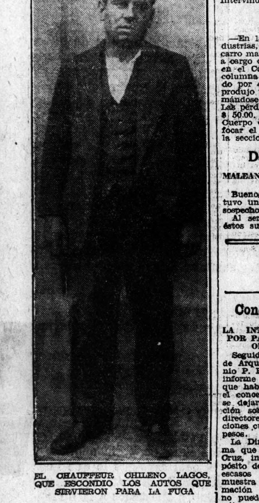
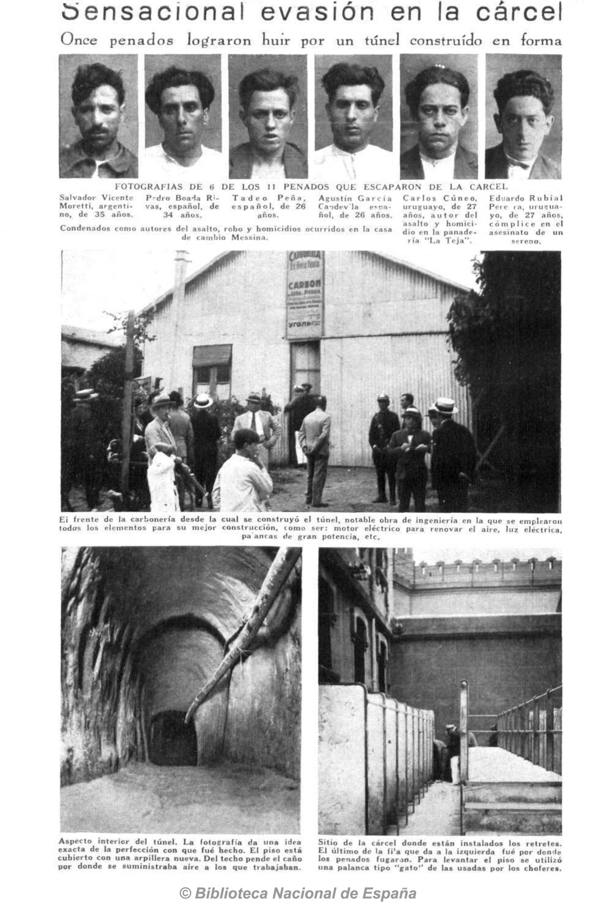
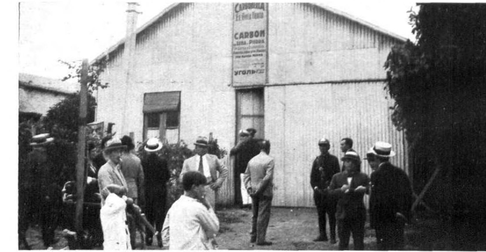
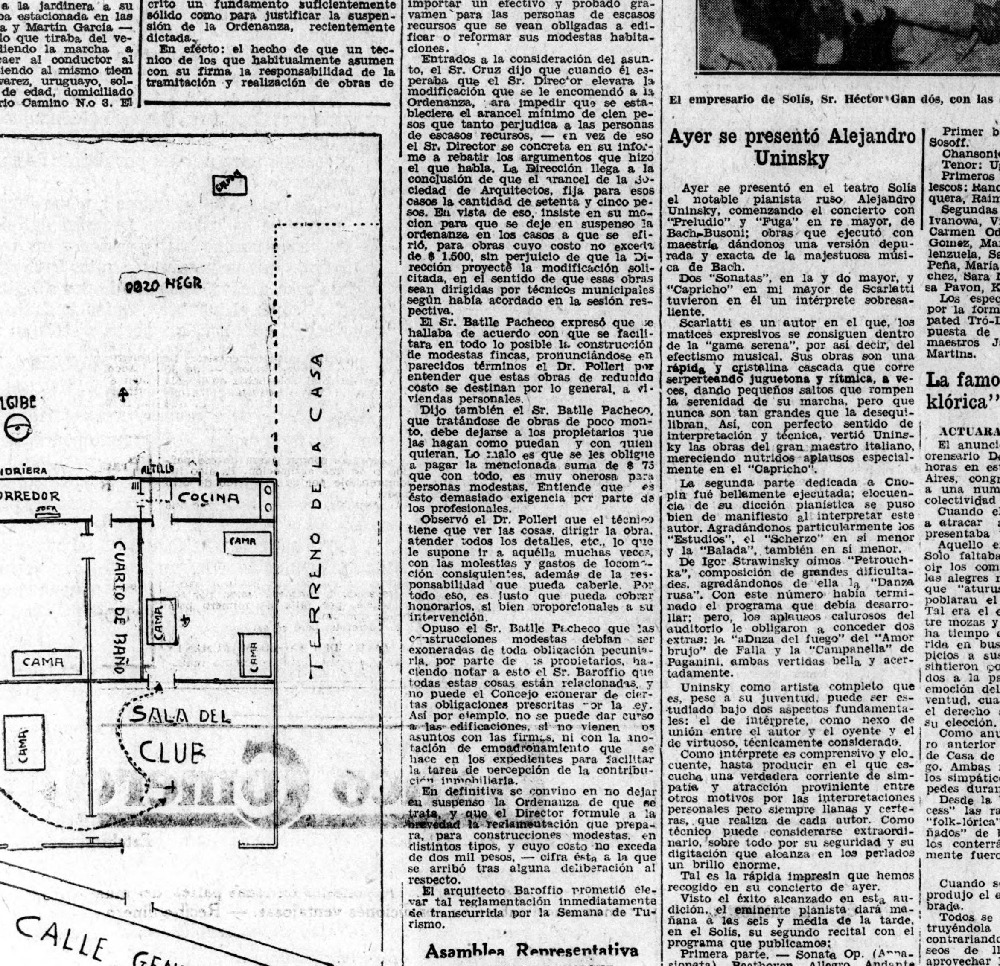
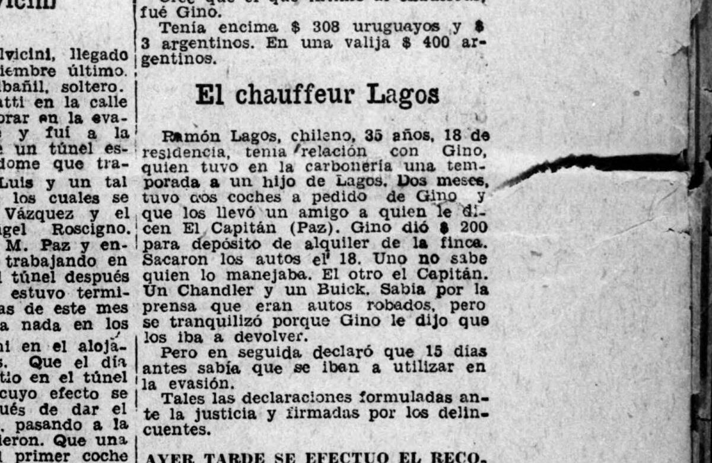
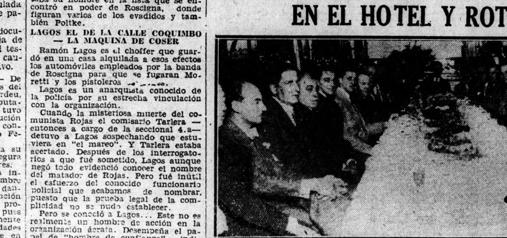
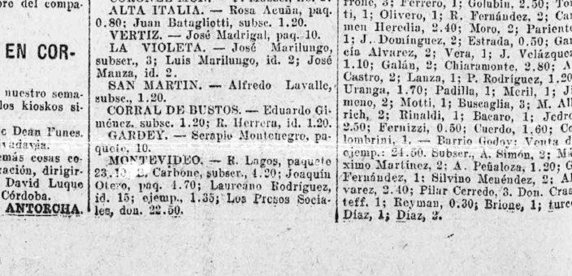

# El hombre de confianza

*Ramón Lagos, un anarquista chileno en el Río de la Plata (1921–1931)*

> «Desempeña el papel de "hombre de confianza" —indicado para dar la cara en el
> alquiler de una finca por ejemplo— que ha de necesitarse, como así aconteció.»
>
> — *La Mañana*, Montevideo, 29 de marzo de 1931

«EL CHAUFFEUR CHILENO LAGOS, QUE ESCONDIO LOS AUTOS QUE SIRVIERON PARA LA FUGA».
*La Mañana*, Montevideo, 27 de marzo de 1931, p. 8.

---

## Nota preliminar

Este cuadernillo no es una biografía definitiva. Es un intento de rescatar la
memoria de un anarquista chileno del que casi no queda rastro, y de hacerlo sin
convertirlo en héroe ni en villano.

No soy historiador. Esto no es un trabajo académico: es una recopilación
documentada, hecha con los medios que tengo y con la intención de que sirva para
seguir buscando. Lo que hay acá son documentos: recortes de prensa, listas de
suscripción, avisos de periódicos, un plano, un retrato. Están citados para que
cualquiera pueda verificarlos, corregirlos o desmentirlos. No hay aquí una tesis
que defender.

El problema es que esos documentos podrían hablar de **tres hombres distintos**
o de **uno solo**. Un delegado obrero fusilado en Punta Alta en 1921 y dado por
muerto; un consejero de la FORA que administraba un periódico en Buenos Aires y
recibía la correspondencia de otro en Bahía Blanca entre 1923 y 1926; un chofer
chileno detenido en Montevideo en 1931 por haber guardado los autos de la fuga de
Punta Carretas. Parecen compartir oficio, nacionalidad y militancia. No tenemos
el documento que los una. Puede que sea el mismo hombre. Puede que no.

Elegimos contarlo así, con esa duda a la vista, porque la duda es parte de lo que
se puede decir con honestidad sobre una vida de la que no quedan cartas, ni
escritos, ni fotografías hasta 1931. Lo que quedó es lo que otros escribieron
sobre él: la policía, los diarios, los compañeros que lo recordaron décadas
después.

Si algo de esto sirve para que alguien aporte un dato, corrija un error o sepa
que este hombre existió, el cuadernillo habrá cumplido.

---

## 1. Un muerto que volvió del bosque

### Punta Alta, noviembre de 1921

A fines de 1921 la Patagonia argentina era un territorio militarizado. La huelga
de los peones rurales, iniciada en el sur de Santa Cruz, había sido respondida con
fusilamientos, y las tropas recorrían los pueblos deteniendo a los huelguistas.
Punta Alta, en el sur de la provincia de Buenos Aires, fue uno de esos pueblos.

Sobre lo que pasó allí tenemos dos relatos de supervivientes, escritos de forma
independiente y con diferencias que no hemos podido resolver. Los dos nombran a un
«compañero Lagos».

El primero es un folleto que la Federación Obrera Local Bonaerense publicó en 1922
bajo el título *La Patagonia Argentina*. Su autor es un obrero argentino que
escribe desde «este hospitalario pueblo chileno» —Punta Arenas— a mediados de
diciembre de 1921, todavía convaleciente «de las dos heridas recibidas en la
"formidable" batalla de Punta Alta». Cuenta la escena de segunda mano, por lo que
le contaron otros sobrevivientes:

> «Avanzaron unos pasos más en la hilera y Douglas volvió a conocer a otro. Esta
> vez era el compañero Lagos; retirado a dos pasos de la fila, Douglas le disparó
> dos tiros, uno que fué a herirlo en un costado y otro en el frontal. Este
> compañero cayó y como las heridas no eran de muerte, al volver en sí, notó que
> las tropas se habían retirado unos metros. Un grupo de conscriptos que estaba
> más cercano, juntaban y amontonaban leña. Comprendiendo el compañero Lagos que
> lo que se quería hacer era quemar los cadáveres, esperó a que se alejaran unos
> metros más en busca de la leña y arrastrándose por entre sus compañeros
> yacentes, pudo internarse en el bosque y que felizmente a esa idea hoy pude
> contarse entre nosotros, aunque en estado bastante grave.»

El segundo relato es el que Osvaldo Bayer reconstruye en *Los vengadores de la
Patagonia trágica*, a partir del testimonio de un obrero chileno recién llegado de
Chile al que llama **Vargas**. En la versión de Bayer, el «compañero Lagos» tiene
nombre y apellido, y una anécdota que el folleto no recoge:

> «"Como hacía poco que había llegado de Chile, no entendía nada de lo que tenía
> que ver con la huelga, pero me sumé a la columna porque no tenía otra opción."
> […] Nuestro delegado, Ramón Lagos, los obligó a desenganchar los caballos y a
> seguirnos.»

> «El Turco apuntó directamente a Lagos. El comisario Douglas entonces le disparó
> a Lagos sin pestañear. Lagos cayó al suelo gritando "¡Ay, mi madre!". Quedó allí,
> inmóvil. Pero la bala solo le había rozado el cráneo. […] El comisario Douglas
> le disparó otra vez, pero otra vez falló. (Por lo que Lagos me contó después, la
> bala fue detenida por el pañuelo de seda que llevaba alrededor del cuello y ni
> siquiera llegó a la camisa.)»

Las dos versiones coinciden en lo esencial: Lagos es fusilado, cae y sobrevive.
Discrepan en casi todo lo demás. El folleto dice que lo hieren en un costado y en
el frontal, y que escapa arrastrándose mientras los conscriptos juntan leña. Bayer
dice que la bala le roza el cráneo, que un pañuelo de seda la detiene, y que hay un
segundo disparo.

Y hay una discrepancia mayor, que conviene decir en voz alta: Bayer atribuye su
testimonio a *El Trabajo* de Punta Arenas. El folleto de la FOLB, en cambio, ataca
explícitamente a ese diario. O Bayer confunde la fuente, o existieron dos
versiones, o el recuerdo de Vargas se mezcló con lo que leyó después. No tenemos
manera de resolverlo con lo que está digitalizado.

> **Nota.** Las citas de Bayer están retraducidas de la edición inglesa de 2016;
> la versión española puede decir otra cosa.

Lo que sí puede decirse es más modesto y más firme: en noviembre de 1921, en Punta
Alta, hubo un anarquista al que sus compañeros llamaban Lagos, que fue fusilado y
que no murió. Que se llamara Ramón, que fuera chileno y que fuese el mismo hombre
que aparece diez años después en Montevideo es una hipótesis de Bayer, no un dato
de la época. La sostenemos como hipótesis.

---

## 2. Tacuarí 653

### Buenos Aires, 1923

La segunda huella es administrativa, y por eso mismo más precisa.

En febrero de 1923, *La Protesta* publica una denuncia interna. En el Comité Pro
Local de la FORA, en Tacuarí 653, alguien durmió una siesta y le robaron
doscientos treinta y dos pesos del bolsillo del pantalón. El damnificado era el
consejero del Comité:

> «el martes 13 del corriente […] el compañero R. Lagos, actual Consejero,
> dormitaba […] sustraída de un bolsillo del pantalón la cantidad de doscientos
> treinta y dos pesos pertenecientes al Comité Pro Local […] Como el golpe
> afectaba grandemente al Comité […] varios compañeros se interesaron en el
> asunto para aclararlo.»

El culpable es un tal Federico Nicolás, recién llegado a la capital, a quien la
organización había alojado por caridad:

> «como es de práctica entre los anarquistas, se les procuró inmediata ayuda y la
> compañera e hija fueron acogidas en el hogar del camarada Lagos […] es a causa
> de nuestra ignorancia a su respecto, que se le dió entrada en la familia de
> Lagos, dándole así ocasión de [robar].»

La denuncia la firman «los compañeros E. Fabeiro, Jacobo Barro, A. Angueira, Angel
Petrarca, Antonio López, Miguel Rivera, Ramón Lagos y A. Bianchi». Es decir: Lagos
no es solo el damnificado. Es uno de los que firman la acusación.

Y su casa —no el local del comité, su casa— es el lugar donde se aloja a la mujer
y la hija de un desconocido. El dato está escrito al pasar, en una denuncia por
doscientos treinta y dos pesos, y sin embargo describe una práctica: la casa del
militante como alojamiento de quien llega.

El mismo mes, *La Antorcha* —el periódico que se vendía en Tacuarí 653— publica un
aviso de administración:

> «Por suscripciones y demás dirigirse a Ramón Lagos.»

En julio de 1923 vuelve a aparecer, esta vez en el núcleo duro de la FORA. Cuando
la Federación investiga un documento falsificado que se atribuye a uno de sus
dirigentes, nombra una comisión de cinco delegados:

> «Los delegados nombrados para realizar esta labor, son los compañeros Miguel
> González, Alfredo Elías, A. Lorenzo, Vicente Tomé y Ramón Lagos, quienes en
> momentos de entrar el diario en máquina inician sus funciones.»

El informe del 30 de junio y la reunión del 4 de julio repiten los mismos cinco
nombres. Al menos uno de ellos, Vicente Tomé, aparece también en la contabilidad
de *La Antorcha* de 1926, junto al propio Lagos. Es un grupo pequeño, de
confianza, que administra, firma, cobra y denuncia.

Nada de esto dice que Lagos fuera chileno. Nada de esto dice que fuera chofer.
Solo dice que en 1923 era alguien con peso dentro de la FORA porteña y que su casa
servía de refugio.

---

## 3. El buzón de Villa Mitre

### Bahía Blanca, 1925–1927

En diciembre de 1925, *La Antorcha* publica el balance de una colecta:

> «Lista No. 160, a cargo de Ramón Lagos, Bahía Blanca: V. de la Fuente $ 1,
> A. Lozano 1, J. Riobó 0.50, F. de Toer 1, H. Pérez 0.50, M. R. 1, R. Lagos 1.
> Total $ 6.»

Seis pesos. Es una lista modesta, de barrio, con un «R. Lagos» entre los
suscriptores que puede ser él mismo o un pariente. Lo interesante no es el monto
sino el cargo: «a cargo de Ramón Lagos, Bahía Blanca». Alguien tiene que cobrar
puerta por puerta, llevar la cuenta y hacer llegar el dinero al periódico. Ese
alguien, en Bahía Blanca, es Lagos.

En enero de 1926 la cosa se formaliza. *Brazo y Cerebro*, periódico anarquista de
Bahía Blanca, imprime en su cabecera:

> «CORRESPONDENCIA Y VALORES A RAMON LAGOS (Sucursal de Correos Villa Mitre)
> Calle Marpú Nro. 124 — BAHÍA BLANCA»

Y en el número de mayo agrega:

> «Todo lo relacionado con BRAZO Y CEREBRO diríjase a su debida dirección, y a
> nombre de R. Lagos.»

Durante esos meses, Lagos es el buzón y la caja del periódico. Toda la
correspondencia —suscripciones, canjes, cartas de otros grupos, dinero— pasa por
su nombre y por una dirección en el barrio de Villa Mitre.

Para una publicación que la policía seguía de cerca, eso significa dos cosas:
confianza y disposición a figurar. La dirección de un periódico anarquista no era
un dato cualquiera.

Los números siguientes muestran que la dirección era un puesto, no una propiedad.
En julio de 1926 la correspondencia pasa a «Norberto Maillo, Villa Mitre, calle
Maipú 124». En enero de 1927, a «Oscar Peralta». En mayo de 1927, a «José M.
Fernández, Casilla de Correo 1980, Buenos Aires». La cadena de nombres muestra que
el lugar era una función rotativa: alguien ponía la cara, y cuando esa persona se
iba, la reemplazaba otra.

Un detalle que no sabemos interpretar: en marzo de 1926, *La Antorcha* registra a
«Ramón Lagos, Ciudad» cobrando suscripciones en Buenos Aires, con una lista que
incluye a un **Lorenzo Lagos**. En el mismo período figuraba como responsable en
Bahía Blanca. Bahía Blanca está a varios cientos de kilómetros de Buenos Aires.
Puede ser un viaje, puede ser un homónimo, puede ser que Lagos tuviera dos
domicilios. No lo sabemos.

> **Nota sobre la calle.** El nombre aparece en los OCR como «Marpú», «Marrú» y
> «Marín», según el número. Pero el sucesor en el mismo domicilio, Norberto
> Maillo, figura en la calle **Maipú 124**, en Villa Mitre. Lo más probable es
> que «Marpú» sea una mala lectura de Maipú. El punto queda pendiente de
> confirmación con un callejero de Bahía Blanca.

---

## 4. Coquimbo 2314

### Montevideo, marzo de 1931

El 18 de marzo de 1931, once presos se fugaron del penal de Punta Carretas por un
túnel excavado desde una carbonería situada enfrente, «El Buen Trato». El túnel
tenía luz eléctrica, arpillera nueva en el piso y un caño para renovar el aire. La
operación había necesitado, además de los presos y los pistoleros, una
infraestructura de casas, autos y dinero.

Días después, mientras la policía todavía buscaba a los fugitivos, el comisario
Marchese detuvo a un hombre en la esquina de 18 y Río Branco. Se llamaba Ramón
Lagos, era chileno, tenía treinta y cinco años y era chofer. Su detención fue
anterior —dos días antes, según O'Neill— a la del grupo que se escondía en la casa
de la calle Curupí.

*La Mañana* del domingo 29 de marzo de 1931 le dedica dos notas, en las páginas 5
y 14. La primera empieza así:

> «Ramón Lagos es el choffer que guardó en una casa alquilada a esos efectos los
> automóviles empleados por la banda de Roscigna para que se fugaran Moretti y los
> pistoleros.»

Y sigue con la frase que da título a este cuadernillo:

> «Lagos es un anarquista conocido de la policía por su estrecha vinculación con
> la organización. […] Este no es recientemente un hombre de acción en la
> organización ácrata. Desempeña el papel de "hombre de confianza" —indicado para
> dar la cara en el alquiler de una finca por ejemplo— que ha de necesitarse, como
> así aconteció.»

La nota agrega un episodio anterior, sin fecha. Lagos había sido detenido antes,
por el comisario Tarlera, a raíz de la «misteriosa muerte del comunista Rojas». Lo
interrogaron, negó todo, pero «evidenció conocer el nombre del matado». No pudieron
probarle nada. Es el único hecho de su vida que la prensa de 1931 menciona fuera
de la fuga, y viene de la policía que lo vigilaba.

La segunda nota, en la página 14, describe la casa:

> «En la calle Coquimbo —como hemos informado— en una finca señalada con el número
> 2314, reside el choffer Ramón Lagos en unión de su compañera Miguelina Costa. […]
> Lagos residió anteriormente en unas piezas que alquilaba en la calle 25 de
> Agosto, a la altura del 582, pero hace algún tiempo expresó a su compañera que
> deseaba alquilar una casa más grande… Y se mudó a la calle Coquimbo.»

Y más abajo:

> «A esa finca destinada a ser famosa, con varias piezas y un galpón aparente para
> guardar vehículos concurrían varios amigos de Lagos, que debe suponerse eran
> todos ácratas, dado el papel que en la organización anárquica desempeña este
> chofer. […] Se ha establecido igualmente que el alquiler de la finca no corría
> por cuenta de Lagos sino de sus "amigos"».

Todo el mecanismo está ahí, en dos párrafos de diario: la casa alquilada por él,
el alquiler pagado por otros, el galpón para los autos, los «amigos» que van y
vienen. No hay indicios de que Lagos dirigiera la operación. Era la persona que
daba la cara.

Su declaración, transcrita en un recuadro de la misma página bajo el título «El
chauffeur Lagos», es el documento más directo que tenemos:

> «Ramón Lagos, chileno, 35 años, 18 de residencia, tenía relación con Gino, quien
> tuvo en la carbonería una temporada a un hijo de Lagos. Dos meses, tuvo dos
> coches a pedido de Gino y que los llevó un amigo a quien le dijo el Capitán
> (Paz). Gino dió $ 200 para depósito de alquiler de la finca. Sacaron los autos
> el 18. Uno no sabe quién lo manejaba. El otro el Capitán. Un Chandler y un
> Buick. Sabía por la prensa que eran autos robados, pero se tranquilizó porque
> Gino le dijo que los iba a devolver.
>
> Pero en seguida declaró que 15 días antes sabía que se iban a utilizar en la
> evasión.»

Un hijo suyo había vivido una temporada en la carbonería. Ese es el vínculo más
concreto entre Lagos y el lugar del túnel, además del de la máquina de coser. Y la
máquina de coser fue lo que lo perdió: la policía descubrió su participación porque
Lagos era **el adjudicatario de la máquina de coser hallada en la carbonería de
«El Buen Trato»**. Un objeto doméstico, una adjudicación, un nombre en un papel.

Dos coches, un Chandler y un Buick, sacados el día 18. Doscientos pesos de depósito
pagados por Gino Gatti. Un «Capitán» que la nota identifica con Paz. Y un hombre de
treinta y cinco años que declara haber sabido quince días antes que esos autos iban
a servir para una fuga, y que igual los guardó.

---

## 5. El retrato que lo delató

Dos días antes de las notas del 29 de marzo, *La Mañana* había publicado su
retrato. Está en la página 8 del viernes 27, en la misma página que el plano de la
casa de Curupí y otro retrato de Roscigna, «sin la gorra y los anteojos oscuros».
El pie de foto dice:

> «EL CHAUFFEUR CHILENO LAGOS, QUE ESCONDIO LOS AUTOS QUE SIRVIERON PARA LA FUGA»

Y la página 14 del 29 de marzo explica para qué sirvió esa publicación:

> «Pero este sujeto, al publicarse en LA MAÑANA el retrato del chauffeur chileno
> Lagos, fué reconocido como el titulado Aquino.»

Es decir: el retrato no ilustra la noticia, la produce. Alguien vio la foto y dijo
«ese es Aquino». No sabemos si Aquino era un alias suyo, una identidad que usaba
en otro círculo o una confusión de la policía. La nota no lo aclara. Pero el
mecanismo queda a la vista: un hombre al que se podía reconocer por la cara antes
que por el nombre.

> **Nota.** Es la única imagen que tenemos de él, y es de 1931, cuando tenía
> treinta y cinco años. Todo lo anterior —Punta Alta, Tacuarí 653, Villa
> Mitre— es texto sin rostro.

---

## 6. Lo que no sabemos

Reunidos, los documentos dicen esto:

| Fecha | Lugar | Qué hace | Fuente |
|---|---|---|---|
| nov. 1921 | Punta Alta | Delegado de columna; fusilado y sobrevive | FOLB, 1922; Bayer, 2016 |
| feb. 1923 | Buenos Aires | Consejero del Comité Pro Local; su casa es refugio | *La Protesta*, 20/02/1923 |
| 1923 | Buenos Aires | Administra las suscripciones de *La Antorcha* | *La Antorcha*, feb. 1923 |
| jul. 1923 | Buenos Aires | Delegado de la FORA en la comisión del documento falsificado | *La Protesta*, jul. 1923 |
| dic. 1925 | Bahía Blanca | Colecta para *La Antorcha* | *La Antorcha*, 11/12/1925 |
| 1926 | Bahía Blanca | Buzón y caja de *Brazo y Cerebro* | *Brazo y Cerebro*, 1926 |
| sept. 1927 | Montevideo | «R. Lagos» envía un paquete a *La Antorcha* (¿es él?) | *La Antorcha*, 30/09/1927 |
| mar. 1931 | Montevideo | Detenido como apoyo logístico de la fuga | *La Mañana*, 29/03/1931 |

Lo que la tabla no dice es si todas esas filas son la misma persona. La hipótesis
de lectura que sostiene este cuadernillo —el «hombre de confianza» como parte de
la infraestructura del anarquismo rioplatense— es una interpretación, no un
resultado de archivo.

**A favor:**

- el oficio de chofer aparece en 1931 y es compatible con la movilidad entre
  Buenos Aires, Bahía Blanca y Montevideo;
- la nacionalidad chilena de 1931 coincide con el relato patagónico;
- la militancia anarquista aparece en las tres fuentes, y la pertenencia a la
  FORA en dos de ellas;
- la edad —treinta y cinco años en 1931, es decir, nacido hacia 1896— es la
  adecuada para ser delegado en 1921 y consejero en 1923.

**En contra:**

- ninguna fuente de 1931 menciona su pasado patagónico ni su paso por la FORA
  porteña, y la policía uruguaya solía destacar los antecedentes de los detenidos;
- ninguna fuente de 1923–1926 dice «chileno» junto al nombre;
- la fórmula «18 de residencia» es ambigua: puede significar dieciocho años en
  Chile, en la Argentina, en Uruguay o en el Río de la Plata, y cada lectura
  cambia la cronología.

**Lo que falta:** el expediente judicial del sumario por la fuga, que instruyó el
juez Bolívar Baliñas en 1931. Debería tener filiación completa, fotografía,
domicilios anteriores y antecedentes. No lo hemos consultado; debería estar en el
Archivo General de la Nación de Montevideo. Es el documento que más podría aportar.

Mientras tanto, lo que podemos decir es esto: puede que hayamos escrito la vida de
un solo hombre, y puede que hayamos escrito tres vidas que se parecen. El
cuadernillo no resuelve la duda; la deja planteada, con todos los papeles sobre la
mesa.

---

## 7. Documentos

### 7.1. La fuga, vista desde la carbonería

«Sensacional evasión en la cárcel. Once penados lograron huir por un túnel
construido en forma…».
*Caras y Caretas*, Buenos Aires, 28 de marzo de 1931, Nº 1695.

Arriba, los retratos de seis de los once evadidos: Moretti, Boada Rivas, Peña,
García Cadevla, Cúneo y Rubial Pereyra. En el centro, la única fotografía que hemos
encontrado del frente de la carbonería «El Buen Trato», con el cartel pintado a
mano. Abajo, el interior del túnel y el patio de la cárcel.

«El frente de la carbonería desde la cual se construyó el túnel».
*Caras y Caretas*, 28 de marzo de 1931. Allí estuvo alojado, una temporada, un hijo
de Lagos.

### 7.2. El retrato

«EL CHAUFFEUR CHILENO LAGOS, QUE ESCONDIO LOS AUTOS QUE SIRVIERON PARA LA FUGA».
*La Mañana*, 27 de marzo de 1931, p. 8.

### 7.3. El plano de la casa de Curupí

«Plano de la planta de la casa en que fueron encontrados Roscigna, Malvicini,
López y Díaz y el punto que termina en una X indica el camino que siguió el
inspector Bonino…».
*La Mañana*, 27 de marzo de 1931, p. 8.

### 7.4. La declaración

*La Mañana*, 29 de marzo de 1931, p. 14.

### 7.5. El artículo de la calle Coquimbo

*La Mañana*, 29 de marzo de 1931, p. 5.

### 7.6. Un rastro de 1927

«MONTEVIDEO. — R. Lagos, paquete 23.12…».
*La Antorcha*, Buenos Aires, 30 de septiembre de 1927, p. 4. La inicial no permite
afirmar que sea él, pero la coincidencia de red y de ciudad es sugerente.

> **Advertencia sobre las imágenes.** Los escaneos de *La Mañana* provienen de la
> digitalización de la Universidad de California en Internet Archive. Los de
> *Caras y Caretas* provienen de la Biblioteca Nacional de España y llevan su
> marca de agua. Antes de imprimir hay que verificar caso por caso el estado de
> dominio público y las condiciones de reutilización; para una edición impresa
> conviene trabajar con los originales de la Biblioteca Nacional de Uruguay y de
> la Hemeroteca de Montevideo.

---

## 8. Cronología

| Fecha | Hecho |
|---|---|
| ¿1913? | Llegada al Río de la Plata, si «18 de residencia» se lee como años en el país |
| noviembre de 1921 | Fusilado en Punta Alta junto a otros huelguistas; sobrevive |
| febrero de 1923 | Consejero del Comité Pro Local de la FORA; su casa aloja a la mujer y la hija de un desconocido |
| febrero de 1923 | «Por suscripciones y demás dirigirse a Ramón Lagos» (*La Antorcha*) |
| 30 de junio – 5 de julio de 1923 | Delegado de la FORA en la investigación del documento falsificado |
| 11 de diciembre de 1925 | «Lista No. 160, a cargo de Ramón Lagos, Bahía Blanca» |
| enero–mayo de 1926 | Buzón y caja de *Brazo y Cerebro* en Villa Mitre |
| 30 de septiembre de 1927 | «R. Lagos, Montevideo» en la colecturía de *La Antorcha* |
| sin fecha (antes de 1931) | Detenido por el comisario Tarlera a raíz de la muerte del comunista Rojas; sin pruebas |
| marzo de 1931 | Detenido en 18 y Río Branco, dos días antes que el grupo de Roscigna |
| 27 de marzo de 1931 | *La Mañana* publica su retrato; es reconocido como «el titulado Aquino» |
| 29 de marzo de 1931 | *La Mañana* publica dos notas y su declaración |
| abril–mayo de 1931 | **Sin datos.** Faltan los números 4939–4980 de *La Mañana* |
| resto de 1931 | **Sin datos.** No aparece en el *Diario Oficial* de Uruguay de ese año |

---

## 9. Fuentes

### Fuentes primarias

- *La Mañana* (Montevideo), 27 y 29 de marzo de 1931. Digitalización de la
  Universidad de California en Internet Archive:
  <https://archive.org/details/LaManana_4898_4938>
- *Caras y Caretas* (Buenos Aires), Nº 1695 (28/03/1931) y Nº 1696 (04/04/1931).
  Biblioteca Nacional de España:
  <https://archive.org/details/Caras_y_Caretas_Buenos_Aires_1931-03-28_N_1695> y
  <https://archive.org/details/Caras_y_Caretas_Buenos_Aires_1931-04-04_N_1696>
- *La Protesta* (Buenos Aires), febrero y julio de 1923:
  <https://archive.org/details/laprotesta1923-II> y
  <https://archive.org/details/laprotesta1923-VII>
- *La Antorcha* (Buenos Aires), 1923, 1925, 1926 y 1927:
  <https://archive.org/details/laantorcha1923-I>,
  <https://archive.org/details/laantorcha1925>,
  <https://archive.org/details/laantorcha1926-I>,
  <https://archive.org/details/laantorcha1927>
- *Brazo y Cerebro* (Bahía Blanca), 1926–1927:
  <https://archive.org/details/brazoycerebro1926-1927>
- *La Patagonia Argentina* (Federación Obrera Local Bonaerense, 1922):
  <https://archive.org/details/la-patagonia-argentina-1922-compressed>
- *Diario Oficial de la República Oriental del Uruguay*, 1931 (288 números
  consultados): <https://archive.org/details/DiarioOficialUruguay_19310102> y
  siguientes.

### Fuentes secundarias

- Osvaldo Bayer, *Rebellion in Patagonia*, AK Press, 2016 (edición inglesa de
  *Los vengadores de la Patagonia trágica*):
  <https://archive.org/details/rebellion-in-patagonia-osvaldo-bayer>
- Fernando O'Neill Cuesta, *Direct Action in Montevideo: Uruguayan Anarchism,
  1927–1937*, AK Press, 2020:
  <https://archive.org/details/isbn_9781849353199>

### Búsquedas negativas

- 599 números de *La Protesta* (Buenos Aires), *La Antorcha*, *Brazo y Cerebro* y
  *La Protesta* (Santiago de Chile), entre 1922 y 1935: **ninguna mención de
  «Ramón Lagos»** fuera de los registros citados, y **ningún texto firmado por
  él**.
- *Diario Oficial* de Uruguay, 1931: **ninguna mención de «Ramón Lagos»**; si hubo
  decreto de expulsión, no se publicó allí.

---

## 10. Sobre esta edición

Este texto es un borrador de trabajo, no una edición cerrada. M.A.R.E.A. lo
publicará en su colección Historia cuando la investigación permita cerrar, al
menos, dos cosas: la verificación de la calle de Bahía Blanca y la consulta del
expediente del juez Baliñas en Montevideo.

Los documentos citados se transcriben respetando su ortografía y su puntuación,
incluidas las erratas, pero se modernizan las tildes y el uso de mayúsculas. Las
lecturas dudosas se señalan en el texto. Las imágenes se incluyen como facsímiles
de trabajo; su estado de derechos debe verificarse antes de cualquier reimpresión.

> Si tenés un dato, una carta, una foto o una corrección, escribinos. Este
> cuadernillo se hizo para eso.

---

*M.A.R.E.A. Editorial Anarquista — Colección Historia*
